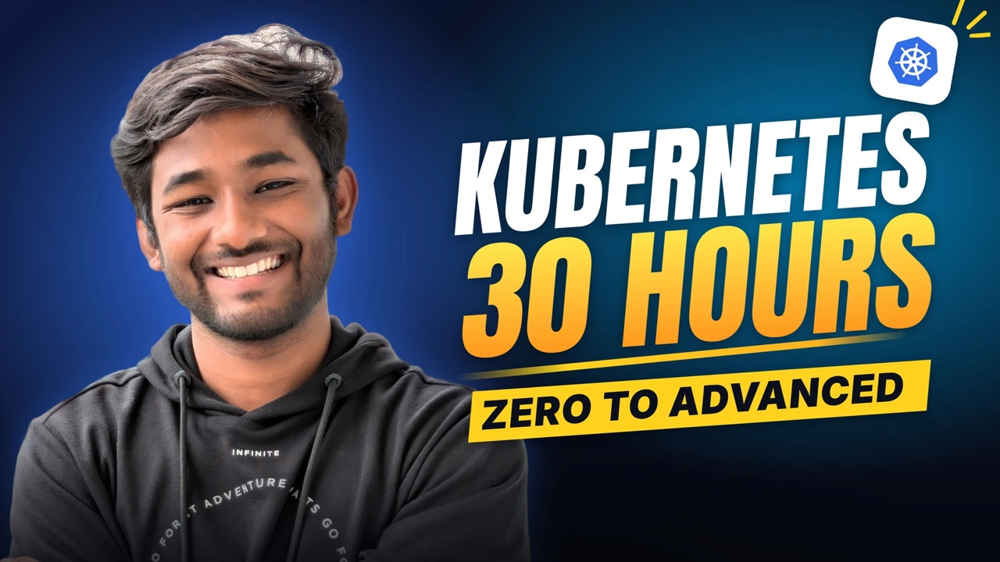
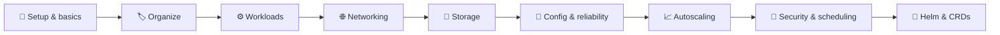

<div align="center">

# ☸️ Learn Kubernetes by Actually Building It

### A free, hands-on course that takes you from "why do we even need Kubernetes?" to running real apps on a cluster.

[](https://github.com/theshubhamgour/kubernetes-tutorial)
[](https://github.com/theshubhamgour/kubernetes-tutorial/fork)
[](https://www.youtube.com/shubhamgourtech?sub_confirmation=1)

<a href="https://www.youtube.com/playlist?list=PLBr8obKbpkYvNosYrgzEayOCe1d_MY5n-">
  
</a>

**[▶ Watch the course](#-the-course)** &nbsp;·&nbsp; **[🚀 Start in 2 steps](#-start-in-2-steps)** &nbsp;·&nbsp; **[✅ Test yourself](#-can-you-answer-these)**

⭐ **Star this repo to save it for later. It also helps other learners find it.**

</div>

---

## 👋 Why this course?

Many Kubernetes tutorials show you commands. This one shows you **why** they work and **what to do when they don't**.

- 🧠 **Simple explanation first:** every concept starts with a real-world analogy before any YAML.
- ⌨️ **You write the YAML:** you build each manifest from scratch instead of copying a finished one.
- 💥 **Break things on purpose:** you see real failures and troubleshoot them the way DevOps engineers do on the job.
- 📂 **Notes for every lesson:** each module has its own guide and the exact manifests from the video, ready for revision.
- 📖 **Official docs included:** each guide links to the `kubernetes.io` pages for that topic, so you can go deeper.
- 💸 **Completely free:** there's no sign-up and no paywall.

## 🎯 Who it's for

| If you are... | You'll get... |
| :-- | :-- |
| 🌱 **New to Kubernetes** | A clear path through the topics, in the right order |
| 🐳 **Comfortable with Docker** | The next step: running containers at scale |
| 👩‍💻 **A developer** | The confidence to deploy your own apps |
| 🎓 **Preparing for interviews, the CKA or the CKAD** | Hands-on practice and notes you can revise from |

**You'll need** basic Docker knowledge and some comfort with the Linux command line. New to containers? Start with [docker-tutorial](https://github.com/theshubhamgour/docker-tutorial).

---

## 🗺️ Your learning path



By the end, you'll be able to:

- ✅ Set up a cluster with KIND, Minikube or Kubeadm
- ✅ Deploy, update and roll back applications without downtime
- ✅ Expose apps with Services, Ingress and the Gateway API
- ✅ Keep data safe with persistent storage
- ✅ Manage configuration and secrets properly
- ✅ Keep apps healthy and scale them automatically
- ✅ Lock down access with RBAC and NetworkPolicies
- ✅ Package apps with Helm and extend Kubernetes with CRDs

---

## 🚀 Start in 2 steps

**1. Get the code.** [Fork this repo](https://github.com/theshubhamgour/kubernetes-tutorial/fork) to keep your own copy, then clone it:

```bash
git clone https://github.com/<your-username>/kubernetes-tutorial.git
cd kubernetes-tutorial
```

**2. Build your first cluster.** Open **[Module 1](./1-install-kubernetes)**, pick an install option and follow along with the video.

> 💡 **Get the most from it:** watch in order, keep your terminal open, and type the manifests yourself. Typing them is how the syntax sticks.

---

## 📚 The course

**[▶ Watch the full playlist on YouTube](https://www.youtube.com/playlist?list=PLBr8obKbpkYvNosYrgzEayOCe1d_MY5n-)**

> ✅ **Track your progress:** the lists below are checklists. In your fork, change `[ ]` to `[x]` in this file as you finish each module.

### 🧭 Start here

- [ ] Course introduction · [▶ Watch](https://www.youtube.com/watch?v=dlmbhY4RdrQ&list=PLBr8obKbpkYvNosYrgzEayOCe1d_MY5n-)
- [ ] Why Kubernetes? Docker vs Kubernetes · [▶ Watch](https://www.youtube.com/watch?v=bZhN8aPksWo&list=PLBr8obKbpkYvNosYrgzEayOCe1d_MY5n-)
- [ ] What is Kubernetes? Orchestration and desired state · [▶ Watch](https://www.youtube.com/watch?v=sPXJcOAuEt0&list=PLBr8obKbpkYvNosYrgzEayOCe1d_MY5n-)
- [ ] Kubernetes architecture: control plane and worker nodes · [▶ Watch](https://www.youtube.com/watch?v=beYyRumKXZE&list=PLBr8obKbpkYvNosYrgzEayOCe1d_MY5n-)

### 🧱 Setup and core basics

- [ ] **1.** [Install a cluster: KIND, Minikube and Kubeadm](./1-install-kubernetes) · [▶ Watch](https://www.youtube.com/watch?v=wgvZfHApoyM&list=PLBr8obKbpkYvNosYrgzEayOCe1d_MY5n-)
- [ ] **2.** [Key Kubernetes terminology](./2-kubernetes-terminologies) · [▶ Watch](https://www.youtube.com/watch?v=sl1ZY19OTn0&list=PLBr8obKbpkYvNosYrgzEayOCe1d_MY5n-)
- [ ] **3.** [Essential kubectl commands](./3-kubectl-kubernetes) · [▶ Watch](https://www.youtube.com/watch?v=ahdUpVSDn9k&list=PLBr8obKbpkYvNosYrgzEayOCe1d_MY5n-)
- [ ] **4.** [Pods: multi-container, sidecar and pause containers](./4-pods-kubernetes) · [▶ Watch](https://www.youtube.com/watch?v=afo8RyshkGY&list=PLBr8obKbpkYvNosYrgzEayOCe1d_MY5n-)
- [ ] **5.** [Writing Kubernetes YAML manifests](./5-yaml-for-kubernetes) · [▶ Watch](https://www.youtube.com/watch?v=nRbJtb8aqKk&list=PLBr8obKbpkYvNosYrgzEayOCe1d_MY5n-)

### 🏷️ Organizing resources

- [ ] **6.** [Namespaces](./6-namespaces-in-kubernetes) · [▶ Watch](https://www.youtube.com/watch?v=9JE1av22XSA&list=PLBr8obKbpkYvNosYrgzEayOCe1d_MY5n-)
- [ ] **7.** [Labels and selectors](./7-labels-and-selectors) · [▶ Watch](https://www.youtube.com/watch?v=x56bRp-iwaY&list=PLBr8obKbpkYvNosYrgzEayOCe1d_MY5n-)

### ⚙️ Workloads

- [ ] **8.** [Deployments](./8-deployments-in-kubernetes) · [▶ Watch](https://www.youtube.com/watch?v=thWniufHp8Q&list=PLBr8obKbpkYvNosYrgzEayOCe1d_MY5n-)
- [ ] **9.** [ReplicaSet vs Deployment and self-healing](./9-replicaset-vs-deployment) · [▶ Watch](https://www.youtube.com/watch?v=SElsgJbDaog&list=PLBr8obKbpkYvNosYrgzEayOCe1d_MY5n-)
- [ ] **10.** [Rolling updates and rollbacks](./10-rolling-updates-and-rollback) · [▶ Watch](https://www.youtube.com/watch?v=Si9cm1m51Uw&list=PLBr8obKbpkYvNosYrgzEayOCe1d_MY5n-)
- [ ] **11.** [DaemonSets](./11-daemonsets-kubernetes) · [▶ Watch](https://www.youtube.com/watch?v=pTy2w37jloE&list=PLBr8obKbpkYvNosYrgzEayOCe1d_MY5n-)
- [ ] **12.** [Jobs and CronJobs](./12-jobs-and-cronjobs-kubernetes) · [▶ Watch](https://www.youtube.com/watch?v=_taqtPauttQ&list=PLBr8obKbpkYvNosYrgzEayOCe1d_MY5n-)
- [ ] **13.** [StatefulSets, headless Services and a MySQL demo](./13-statefulsets-in-kubernetes) · [▶ Watch](https://www.youtube.com/watch?v=5xMud9LxWEk&list=PLBr8obKbpkYvNosYrgzEayOCe1d_MY5n-)

### 🌐 Networking

- [ ] **14.** [Networking basics: Pod IP, ClusterIP and Services](./14-networking-in-kubernetes) · [▶ Watch](https://www.youtube.com/watch?v=133mAcb66ss&list=PLBr8obKbpkYvNosYrgzEayOCe1d_MY5n-)
- [ ] **15.** [Services: port vs targetPort, Endpoints and DNS](./15-services-in-kubernetes) · [▶ Watch](https://www.youtube.com/watch?v=ZHEv6TJziIg&list=PLBr8obKbpkYvNosYrgzEayOCe1d_MY5n-)
- [ ] **16.** [ClusterIP vs NodePort vs LoadBalancer](./16-clusterip-nodeport-loadbalancer) · [▶ Watch](https://www.youtube.com/watch?v=npGmIRSGD_0&list=PLBr8obKbpkYvNosYrgzEayOCe1d_MY5n-)
- [ ] **17.** [Ingress with the NGINX Ingress Controller](./17-ingress-in-kubernetes) · [▶ Watch](https://www.youtube.com/watch?v=9ZDyggVzkNU&list=PLBr8obKbpkYvNosYrgzEayOCe1d_MY5n-)
- [ ] **18.** [Pod-to-Pod networking and CNI](./18-kubernetes-resource-networking) · [▶ Watch](https://www.youtube.com/watch?v=-GnDBOMNGIk&list=PLBr8obKbpkYvNosYrgzEayOCe1d_MY5n-)
- [ ] **19.** [Gateway API: from Ingress annotations to HTTPRoute](./19-gateway-api-kubernetes) · [▶ Watch](https://www.youtube.com/watch?v=hInUhNubOZs&list=PLBr8obKbpkYvNosYrgzEayOCe1d_MY5n-)

### 💾 Storage

- [ ] **20.** [Volumes: emptyDir and hostPath](./20-volumes-in-kubenetes) · [▶ Watch](https://www.youtube.com/watch?v=HMqIikPWLBE&list=PLBr8obKbpkYvNosYrgzEayOCe1d_MY5n-)
- [ ] **21.** [PersistentVolumes: lifecycle and reclaim policy](./21-persistent-volumes-kubernetes) · [▶ Watch](https://www.youtube.com/watch?v=bRn4vHuDJn8&list=PLBr8obKbpkYvNosYrgzEayOCe1d_MY5n-)
- [ ] **22.** [PersistentVolumeClaims](./22-pvc-in-kubernetes) · [▶ Watch](https://www.youtube.com/watch?v=ey5-3TGUCTc&list=PLBr8obKbpkYvNosYrgzEayOCe1d_MY5n-)
- [ ] **23.** [StorageClass and dynamic provisioning](./23-storageclass-in-kuberbetes) · [▶ Watch](https://www.youtube.com/watch?v=6PXMndb4oY0&list=PLBr8obKbpkYvNosYrgzEayOCe1d_MY5n-)

### 🔧 Configuration and reliability

- [ ] **24.** [ConfigMaps](./24-configmaps-kubernetes) · [▶ Watch](https://www.youtube.com/watch?v=uKnlrU6kvc0&list=PLBr8obKbpkYvNosYrgzEayOCe1d_MY5n-)
- [ ] **25.** [Secrets](./25-secrets-in-kubernetes) · [▶ Watch](https://www.youtube.com/watch?v=lqljr5wb15E&list=PLBr8obKbpkYvNosYrgzEayOCe1d_MY5n-)
- [ ] **26.** [Probes: liveness, readiness and startup](./26-probes-in-kubernetes) · [▶ Watch](https://www.youtube.com/watch?v=DejT5ejknM4&list=PLBr8obKbpkYvNosYrgzEayOCe1d_MY5n-)
- [ ] **27.** [Requests and limits: QoS and OOMKilled](./27-requests-limits-kubernetes) · [▶ Watch](https://www.youtube.com/watch?v=1nAsxJSsfkw&list=PLBr8obKbpkYvNosYrgzEayOCe1d_MY5n-)

### 📈 Autoscaling

- [ ] **28.** [Horizontal Pod Autoscaler (HPA)](./28-hpa-in-kubernetes) · [▶ Watch](https://www.youtube.com/watch?v=fgXRoLkyehQ&list=PLBr8obKbpkYvNosYrgzEayOCe1d_MY5n-)
- [ ] **29.** [Vertical Pod Autoscaler (VPA)](./29-vpa-in-kubernetes) · [▶ Watch](https://www.youtube.com/watch?v=NFdaLu42PsI&list=PLBr8obKbpkYvNosYrgzEayOCe1d_MY5n-)

### 🔐 Security and scheduling

- [ ] **30.** [RBAC: Role, RoleBinding, ClusterRole and ClusterRoleBinding](./30-RBAC-in-kubernetes) · [▶ Watch](https://www.youtube.com/watch?v=CmabO5t75eM&list=PLBr8obKbpkYvNosYrgzEayOCe1d_MY5n-)
- [ ] **31.** [Service accounts and tokens](./31-service-accounts-in-kubernetes) · [▶ Watch](https://www.youtube.com/watch?v=IajpsLD21RA&list=PLBr8obKbpkYvNosYrgzEayOCe1d_MY5n-)
- [ ] **32.** [Taints and tolerations](./32-taints-and-tolerations-in-kubernetes) · [▶ Watch](https://www.youtube.com/watch?v=yTLvgkQLNKU&list=PLBr8obKbpkYvNosYrgzEayOCe1d_MY5n-)
- [ ] **33.** [Node affinity](./33-node-affinity-kubernetes) · [▶ Watch](https://www.youtube.com/watch?v=L_mLCT8FW6c&list=PLBr8obKbpkYvNosYrgzEayOCe1d_MY5n-)
- [ ] **34.** [Network policies: Ingress vs Egress with Calico](./34-network-policies-in-kubernetes) · [▶ Watch](https://www.youtube.com/watch?v=t17C6RfoZ2k&list=PLBr8obKbpkYvNosYrgzEayOCe1d_MY5n-)

### 🚀 Extending Kubernetes

- [ ] **35.** [Helm: create your first chart](./35-helm-in-kubernetes) · [▶ Watch](https://www.youtube.com/watch?v=_54bTTQ5VyE&list=PLBr8obKbpkYvNosYrgzEayOCe1d_MY5n-)
- [ ] **36.** [Custom Resource Definitions (CRDs)](./36-crd-in-kubernetes) · [▶ Watch](https://www.youtube.com/watch?v=XLOXLDGV454&list=PLBr8obKbpkYvNosYrgzEayOCe1d_MY5n-)

---

## ✅ Can you answer these?

Try these before and after the course. Each answer is in the module linked next to it.

1. Why isn't a Pod's IP address enough for other apps to rely on? ([Module 15](./15-services-in-kubernetes))
2. What's the difference between `port`, `targetPort` and `nodePort`? ([Module 16](./16-clusterip-nodeport-loadbalancer))
3. Why would you use a Deployment rather than a bare ReplicaSet? ([Module 9](./9-replicaset-vs-deployment))
4. What's the difference between a readiness probe and a liveness probe? ([Module 26](./26-probes-in-kubernetes))
5. What does it mean when a container is `OOMKilled`? ([Module 27](./27-requests-limits-kubernetes))
6. What does a Service do when a Pod behind it is replaced? ([Module 15](./15-services-in-kubernetes))
7. Is a Kubernetes Secret encrypted by default? ([Module 25](./25-secrets-in-kubernetes))
8. Why would you choose a StatefulSet for a database? ([Module 13](./13-statefulsets-in-kubernetes))

---

## 🤝 Contributing

Spotted a typo, a broken command or a manifest that fails on a newer Kubernetes version? Please [open an issue](https://github.com/theshubhamgour/kubernetes-tutorial/issues) or send a pull request.

Keep pull requests focused on one module, and mention the Kubernetes version you tested with.

## 📖 Official documentation

- [Kubernetes documentation](https://kubernetes.io/docs/home/)
- [Kubernetes basics tutorial](https://kubernetes.io/docs/tutorials/kubernetes-basics/)
- [Concepts](https://kubernetes.io/docs/concepts/)
- [kubectl quick reference](https://kubernetes.io/docs/reference/kubectl/quick-reference/)

---

<div align="center">

## 🙌 If this helped you

⭐ **[Star this repo](https://github.com/theshubhamgour/kubernetes-tutorial)** · 🍴 **[Fork it](https://github.com/theshubhamgour/kubernetes-tutorial/fork)** · 📣 **Share it with someone learning Kubernetes**

**Made with ❤️ by [Shubham Gour](https://github.com/theshubhamgour)**

[](https://www.youtube.com/shubhamgourtech?sub_confirmation=1)
[](https://www.linkedin.com/in/theshubhamgour/)
[](https://www.instagram.com/theshubhamgour/)

#theshubhamgour #shubhamgour

</div>
